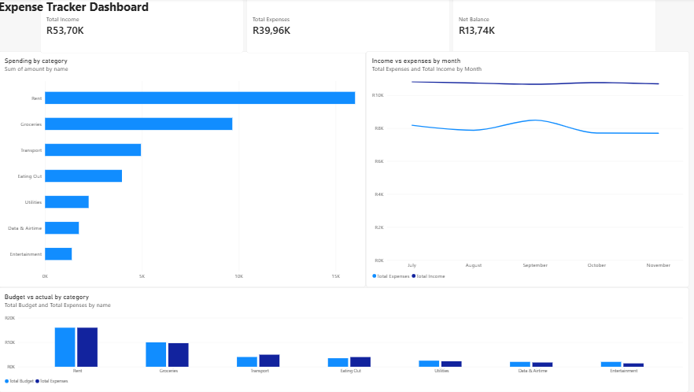
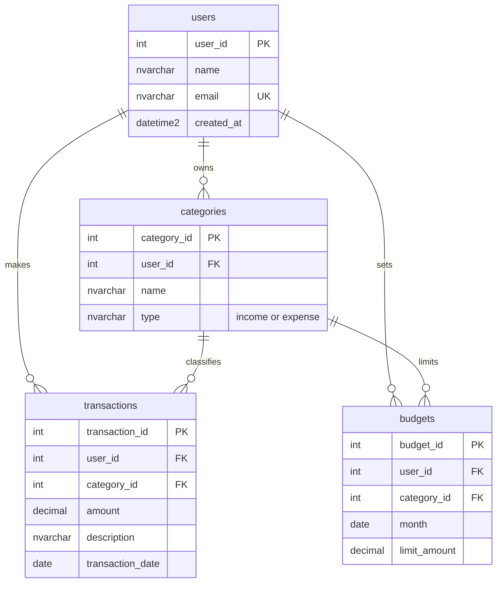
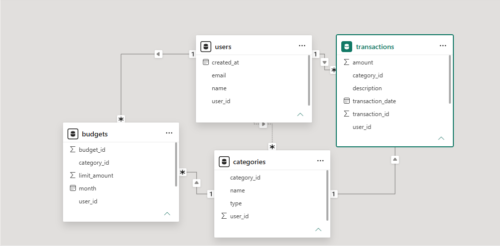

# Expense Tracker: SQL Server Database + Power BI Dashboard

A personal finance database built in **SQL Server (T-SQL)** with a **Power BI** dashboard on top. It tracks income and expenses by category, compares spending against monthly budgets, and shows how money moves month to month.

The project focuses on **database design**: a normalised schema, data integrity rules, indexing, and analytical queries that answer real questions.



## Tech stack

- **Database:** SQL Server (LocalDB), T-SQL
- **Editor:** VS Code with the SQL Server (mssql) extension
- **Reporting:** Power BI Desktop (data model + DAX measures)

## Database design

Four tables in third normal form. Every transaction and budget belongs to a user and a category.



### Design decisions

- **One `transactions` table with a category `type`** (income or expense) instead of separate income and expense tables. Reports across both stay simple, and a new category never needs a schema change.
- **`DECIMAL(10,2)` for money**, never floating point, to avoid rounding errors.
- **Integrity rules in the database, not just the app:**
  - `CHECK (amount > 0)` and `CHECK (limit_amount > 0)` reject nonsense values.
  - `CHECK (type IN ('income','expense'))` keeps categories consistent.
  - `UNIQUE (user_id, name)` on categories and `UNIQUE (user_id, category_id, month)` on budgets prevent duplicates, so a category can only have one budget per month.
  - Foreign keys on every relationship.
- **Index on `transactions (user_id, transaction_date)`**, because nearly every report filters by user and date range.
- **Budgets store the first day of the month** (for example `2026-11-01`), which makes monthly joins a simple date-range comparison.

## Project files

| File | Purpose |
|---|---|
| `schema.sql` | Creates the `ExpenseTracker` database, tables, constraints and index |
| `sample_data.sql` | Loads a demo user, 9 categories, about 5 months of transactions and monthly budgets, then runs check queries |
| `ExpenseTracker.pbix` | Power BI report connected to the database |
| `dashboard.png`, `data-model.png` | Dashboard and data model screenshots |

## How to run it

1. Install SQL Server (Express or LocalDB) and VS Code with the **SQL Server (mssql)** extension.
2. Connect to your server, then run `schema.sql` followed by `sample_data.sql`. Run each file once.
3. Open `ExpenseTracker.pbix` in Power BI Desktop. If the connection fails, go to **Transform data → Data source settings** and point it at your own server name.

## Key query: budget vs actual

Shows each category's monthly budget, what was actually spent, and whether it went over.

```sql
SELECT b.month,
       c.name AS category,
       b.limit_amount AS budget,
       ISNULL(SUM(t.amount), 0) AS actual,
       b.limit_amount - ISNULL(SUM(t.amount), 0) AS remaining,
       CASE WHEN ISNULL(SUM(t.amount), 0) > b.limit_amount
            THEN 'OVER BUDGET' ELSE 'OK' END AS status
FROM budgets b
JOIN categories c ON c.category_id = b.category_id
LEFT JOIN transactions t
       ON t.category_id = b.category_id
      AND t.user_id = b.user_id
      AND t.transaction_date >= b.month
      AND t.transaction_date <  DATEADD(MONTH, 1, b.month)
GROUP BY b.month, c.name, b.limit_amount
ORDER BY b.month, c.name;
```

A `LEFT JOIN` is used so categories with a budget but no spending still appear.

## Power BI dashboard

The report uses the four tables as a star-style model (`transactions` as the fact table, `categories` and `users` as dimensions).



**DAX measures**

```
Total Income   = CALCULATE(SUM(transactions[amount]), categories[type] = "income")
Total Expenses = CALCULATE(SUM(transactions[amount]), categories[type] = "expense")
Net Balance    = [Total Income] - [Total Expenses]
Total Budget   = SUM(budgets[limit_amount])
Budget Variance = [Total Budget] - [Total Expenses]
```

**Visuals**

- Summary cards: total income, total expenses, net balance
- Bar chart: spending by category (filtered to expenses)
- Line chart: income vs expenses by month
- Clustered column chart: budget vs actual by category

## Notes

- The data is **generated sample data** for a single demo user, created to exercise the schema and dashboard. Amounts are in South African rand.

## Next steps

- Add a Flet (Python) front end for entering transactions, writing to the same database
- Add a `date` dimension table for fiscal periods and year-over-year comparisons
- Add stored procedures for common reports

## Author

Zanele Radebe · [GitHub: Zaneradebe6](https://github.com/Zaneradebe6)
